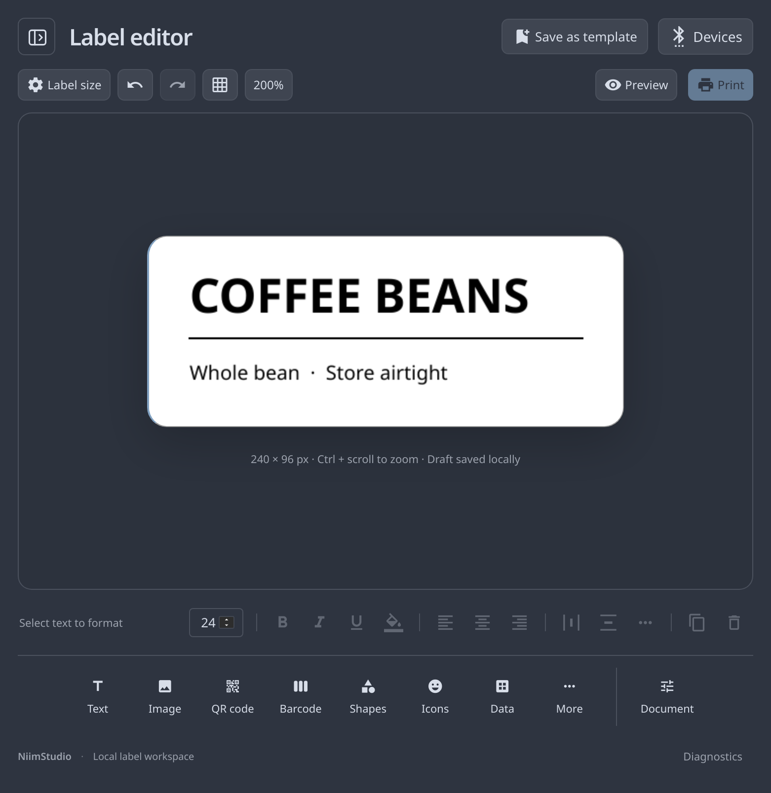

# NiimStudio

A Linux desktop app for making and printing NIIMBOT labels. Open it, design your
label, and print—without a phone app or a cloud account.

NiimStudio is made for **Omarchy**, but it isn't tied to it. On Omarchy it follows
your current palette; on other Linux desktops it follows the native **GTK/Libadwaita
appearance**, including light/dark mode and accent colors. It needs a modern GTK4
desktop, not Omarchy's shell or window manager.



## What you can do

- Edit a centered label with text, fonts, alignment, highlighting, images, shapes,
  icons, QR codes, and barcodes. Rounded stock looks rounded in the preview.
- Paste a link or type content **before** inserting a code, check its live preview,
  and edit it later. Code 128 and EAN-13 values are validated.
- Keep reusable labels in a searchable template sidebar. **Save as template**
  or **Ctrl+S** saves a named copy; your current draft is saved automatically.
- Link a USB or Bluetooth LE printer through **Devices**, including pairing-code
  prompts when needed. Remember the last printer and reconnect without reprinting.
- Automatically use reported stock dimensions, printer DPI, and feed direction—no
  raw size or resolution knobs. Rolls without usable size data get a simple stock
  picker. Existing artwork is never resized without confirmation.
- Preview thermal dithering, margins, density, copies, and CSV batches before printing.
  Export editable JSON or a PNG for backups and reuse.

## Quick start

Install **v0.1.0** with one command on a Linux desktop:

```bash
curl -fsSL https://raw.githubusercontent.com/Akuyumu/niimstudio/main/install.sh | bash
```

Then open **NiimStudio** from your app menu. No Git, Node, npm, AUR, or source
build needed. The script uses a small native bundle when the required GTK/WebKit
runtime is available; otherwise it offers a **Flatpak** with the runtime included.
Flatpak bundles are provided for **x86-64 and ARM64**. Missing packages and the
Flathub runtime repository require consent; **do not run the installer with sudo**.

[Inspect the script, pin a version, update or uninstall](docs/INSTALLING.md).
This targets compatible Linux desktops, not every old kernel or 32-bit system.

<details>
<summary>Build from source instead (developers)</summary>

You need
**Node.js 22.18+**, **Python 3.11+ with PyGObject**, **GTK 4.12+**,
**Libadwaita 1.5+**, **WebKitGTK 6**, and BlueZ for Bluetooth.

### 1. Install the dependencies for your desktop

<details>
<summary>Omarchy / Arch Linux</summary>

On Omarchy:

```bash
omarchy pkg add git nodejs npm gtk4 libadwaita python-gobject webkitgtk-6.0 bluez
```

On another Arch installation, use `sudo pacman -S --needed` with the same package
names instead. A current Node version managed by mise or another version manager
is fine; the app launcher separately finds the system Python with GTK bindings.
</details>

<details>
<summary>Ubuntu 24.04+ / Debian 13+</summary>

```bash
sudo apt update
sudo apt install git python3-gi gir1.2-gtk-4.0 gir1.2-adw-1 gir1.2-webkit-6.0 bluez
```

Also install a current [Node.js LTS](https://nodejs.org/en/download) release.
Ubuntu's older default Node package may not meet the minimum version above.
</details>

<details>
<summary>Fedora / other modern Linux distributions</summary>

```bash
sudo dnf install git nodejs npm gtk4 libadwaita python3-gobject webkitgtk6.0 bluez
```

On other distributions, install the equivalent packages and check the minimum
versions above. Wayland and X11 are supported by GTK; a Bluetooth adapter is only
needed if you choose Bluetooth instead of USB.
</details>

### 2. Build, install the launcher, and open the app

```bash
git clone https://github.com/Akuyumu/niimstudio.git
cd niimstudio
npm ci --ignore-scripts
npm run build
./scripts/install-local
./scripts/niimstudio
```

The user-local install adds **NiimStudio** to your app menu and a `niimstudio`
command in `~/.local/bin`. Keep the source directory in place: the launcher uses
that copy. No root access is needed for the build or launcher installation.

</details>

### Connect your printer

Click **Devices**, then choose USB or scan for Bluetooth LE. Recognized printers
provide the resolution and feed direction; supported rolls also provide their
size. The B1 Pro profile selects **300 DPI** automatically. If the roll does not
report usable dimensions, **Label stock** asks you to choose its packaging size,
not adjust technical settings. Preview one label before starting a batch.
See [printer setup and USB permissions](docs/HARDWARE.md)
if connecting fails. Canceling the chooser simply closes it; it is not an error.

## A few things to know

**This app is vibe-coded: it was built with AI assistance and iterated through
hands-on feedback.** Automated checks and independent code-decoding tests are
included, but that is not a substitute for testing a physical printer.

The current build has been exercised on Omarchy. Support for other modern Linux
desktops is designed into the launcher and theme handling; it is not a claim that
every distribution or printer model has been tested. USB/BLE printing, real
pairing prompts, and printer-fault recovery still need the
[hardware acceptance checklist](docs/HARDWARE.md). Full proprietary NIIMBOT-app
parity, its paid/cloud template catalog, classic Bluetooth SPP, and CUPS integration
are **not** claimed. [Current status and test coverage](docs/STATUS.md).

Automatic stock sizing depends on usable printer/roll metadata; it cannot identify
every third-party roll. Corner rounding is an approximate preview, not a measured
cut radius. Unknown printer profiles and unconfirmed/mismatched stock sizes are
blocked from printing rather than guessed.

Normal editing and printing are offline. The optional ZPL import renderer sends
the ZPL you choose to [Labelary](https://labelary.com); nothing else adds telemetry
or a cloud account. Pairing and printing are never triggered automatically.
Reconnect can be disabled in Devices and never replays an interrupted job.

## Data, themes, and development

Saved labels/drafts are under `~/.local/share/niimstudio/`, device history and the
reconnect preference under `~/.config/niimstudio/settings.json`, and disposable
cache under `~/.cache/niimstudio/` (all respect the corresponding XDG variables).
Flatpak isolates those paths under `~/.var/app/io.github.niimstudio.App/` instead;
native and Flatpak libraries are not automatically merged. See the install guide
before switching formats. Uninstalling either format keeps saved labels/settings.
Use JSON exports as portable backups. On Omarchy the palette is read every two
seconds; **`NIIMSTUDIO_THEME=gtk ./scripts/niimstudio`** opts into system appearance
instead. The printable artwork stays black/white regardless of the UI theme.

```bash
npm run check            # lint, unit tests, type checks, production build
npm run test:smoke       # real GTK/WebKit, isolated data, physical I/O disabled
npm run test:restart     # draft + template persistence across actual processes
npm audit
NIIMSTUDIO_DEBUG=1 ./scripts/niimstudio
```

See [contributing](CONTRIBUTING.md) for UI snapshots, independent QR/barcode
decoding, and the development loop. The optional signed-package runtime in
`scripts/bootstrap-runtime` is an **Arch/Omarchy-only development fallback**, not
the installation method for other Linux distributions. Prefer system WebKit for
security updates.

[Architecture and project map](docs/ARCHITECTURE.md) ·
[Printer setup](docs/HARDWARE.md) · [Status](docs/STATUS.md)

## Project and license

NiimStudio is an **independent desktop project**, with its own UI, GTK integration,
native device handling, and repository. Its label engine is derived from
[NiimBlue](https://github.com/MultiMote/niimblue), and printer communication is
powered by [NiimBlueLib](https://github.com/MultiMote/niimbluelib). Technically,
the editor code is a fork—not wholly original code. We preserve its MIT copyright
and license notices and keep the upstream project separate.

NiimStudio is [MIT licensed](LICENSE). See [upstream attribution](docs/UPSTREAM.md)
for the exact base and dependencies. Not affiliated with or endorsed by NIIMBOT.
